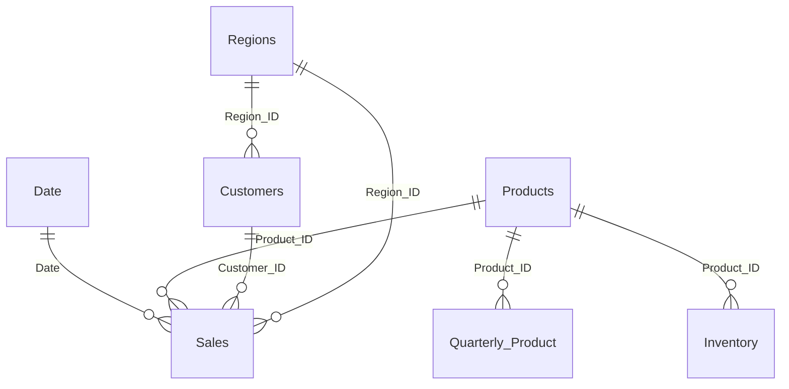

<div align="center">

#  Apple Sales Analytics Dashboard

**A multi-page Power BI dashboard covering sales, products, customers, regions and finance, built on a synthetic Apple-style dataset.**


### 🔗 [**View the Live Interactive Dashboard**](https://app.powerbi.com/view?r=eyJrIjoiMDRiMWE5YWUtZTFmNi00NGYyLThlZGQtODg5YjI4ZWIxMDNkIiwidCI6ImM5YzUwODQ4LWIwM2EtNGJlNC1iNjU1LTZlZGQ3ZmI4MWM1YSJ9)

[](https://app.powerbi.com/view?r=eyJrIjoiMDRiMWE5YWUtZTFmNi00NGYyLThlZGQtODg5YjI4ZWIxMDNkIiwidCI6ImM5YzUwODQ4LWIwM2EtNGJlNC1iNjU1LTZlZGQ3ZmI4MWM1YSJ9)

</div>

---

## 📑 Table of Contents

1. [Project Overview](#-project-overview)
2. [Business Problem](#-business-problem)
3. [Dashboard Pages](#-dashboard-pages)
4. [Key Insights](#-key-insights)
5. [Dataset & Data Model](#%EF%B8%8F-dataset--data-model)
6. [KPI Definitions](#-kpi-definitions)
7. [Tools & Technologies](#%EF%B8%8F-tools--technologies)
8. [Repository Structure](#-repository-structure)
9. [How to Use](#-how-to-use)
10. [Author](#-author)

---

## 🎯 Project Overview

**Apple Sales Analytics** is a Power BI report that turns sales data into decisions. It brings together:

- **Sales performance**: revenue, units, orders and monthly trends
- **Product insights**: category performance, ratings and launch impact
- **Customer analytics**: segments, acquisition, journey and loyalty
- **Regional performance**: countries, stores and growth
- **Financial health**: profit, expenses, cash flow and working capital

The dataset covers **January 2023 to December 2024** (3,000 sales transactions, 1,500 customers, 5 product categories, 17 countries). Most pages can be filtered by **Date, Region, Product, Channel and Country**.

> **Note:** the dataset is **synthetic** and was created for this portfolio project. It does not contain real Apple figures. This project is independent and not affiliated with Apple Inc.

## ❓ Business Problem

A sales leadership team needs one place to answer questions like:

- How is **revenue** trending, and which **products and channels** drive it?
- Which **regions and countries** grow fastest?
- Who are the **customers**, where do they come from, and how many return?
- Is the business **profitable**, and where does the money go?

This dashboard answers them in one interactive report.

---

## 📊 Dashboard Pages

### 🖼️ Landing Page
Entry page with navigation to Sales, Product, Customer, Regional and Finance views.


### 1️⃣ Home
Headline KPIs (revenue, units sold, customers, average selling price), revenue trend, revenue by product category, sales by region, units sold by product, sales channel distribution, top 5 countries and key insights.


### 2️⃣ Sales Dashboard
Monthly revenue and units trend, sales by product category, sales by region with growth, top 5 countries, and a product-by-channel heat matrix.


### 3️⃣ Product Dashboard
Revenue and share per product (iPhone, Mac, iPad, AirPods, Apple Watch), product lifecycle bubble chart, units by quarter, product ratings and launch impact timeline.


### 4️⃣ Customers Dashboard
Customer demographics, customers by type, top segments, customer journey funnel, acquisition sources, location insight and loyalty trend.


### 5️⃣ Region Analysis
Revenue by region, regional performance matrix, revenue contribution, stores vs. revenue by country, market penetration and growth forecast.


### 6️⃣ Finance
Income statement breakdown, expense split, cash flow summary, working capital ratios, year-over-year financial matrix and expense vs. profit analysis.


---

## 💡 Key Insights

Figures below are read from the dashboard screenshots (date range 16-03-2023 to 11-12-2024 on the Home, Sales, Product and Customers pages).

| Area | Insight |
|------|---------|
| **Scale** | **$874M** revenue, **3.40M** units sold, **941** customers and an average selling price of **$257**. |
| **Products** | iPhone leads with **$546.4M** (62.5% of revenue), then Mac ($196.7M), iPad ($100.9M), AirPods ($15.5M) and Apple Watch ($14.5M). |
| **Ratings** | AirPods have the highest rating (**4.62**), followed by Apple Watch (4.59) and iPhone (4.58). |
| **Channels** | **Online** is the largest channel at **45%** of revenue. |
| **Regions** | North America leads with **$404M**, followed by Asia Pacific ($327M) and Europe ($191M). The United States is the top country at **$372.6M**. |
| **Customers** | Customer satisfaction is **4.6/5**. Professionals are the largest segment (30%) and online ads are the top acquisition source (26.9%). |
| **Finance** | Full-year revenue grew from **$473M (2023)** to **$532M (2024)**, a **12.5%** increase. |

> The "vs Last Year" growth of +97.1% shown on several screenshots comes from the selected date range spanning two years. Like-for-like year-over-year growth in the dataset is **12.5%** for revenue and **8.7%** for units. See [`docs/data_dictionary.md`](docs/data_dictionary.md#data-notes) for details.

---

## 🗄️ Dataset & Data Model

The dataset is in [`data/Apple_Analytics_PowerBI_Dataset_FINAL_2023_2024_S.xlsx`](data/Apple_Analytics_PowerBI_Dataset_FINAL_2023_2024_S.xlsx). It has a central `Sales` table connected to date, product, customer and region dimensions, plus supporting tables for finance, inventory, customer journey and reporting.

| Group | Tables |
|-------|--------|
| **Core model** | `Sales` (3,000), `Date` (731), `Products` (5), `Customers` (1,500), `Regions` (12) |
| **Finance** | `Monthly_Finance` (12), `YoY_Summary` (3), `Monthly_YoY` (24), `Dashboard_KPIs` (6) |
| **Product & inventory** | `Quarterly_Product` (20), `Inventory` (5), `Warehouses` (5) |
| **Customer** | `Customer_Journey` (5), `Customer_Loyalty` (12) |
| **Map & reporting** | `ShapeMap_Country` (17), `Reports` (8), `Report_Usage` (12) |
| **Quality** | `Data_Quality` (11 validation checks, all PASS) |

### Data model



Column-level details and data notes are in [`docs/data_dictionary.md`](docs/data_dictionary.md).

---

## 📐 KPI Definitions

| KPI | Definition |
|-----|-----------|
| **Total Revenue** | Sum of `Sales[Revenue]` |
| **Units Sold** | Sum of `Sales[Units_Sold]` |
| **Number of Orders** | Count of `Sales[Sale_ID]` |
| **Total Customers** | Distinct count of `Sales[Customer_ID]` |
| **Avg Selling Price** | Revenue ÷ Units Sold |
| **Gross Profit** | Revenue − COGS |
| **Operating Profit** | Gross Profit − Operating Expense |
| **Net Profit** | Sum of `Sales[Net_Profit]` |
| **Profit Margin** | Net Profit ÷ Revenue |
| **YoY Growth** | Current period vs. `SAMEPERIODLASTYEAR` |
| **Customer Satisfaction** | Average of `Customers[Satisfaction]` |

More detail in [`docs/kpi_definitions.md`](docs/kpi_definitions.md).

---

## 🛠️ Tools & Technologies

- **Power BI Desktop**: data modelling, DAX measures, report design
- **Power Query**: data loading and transformation
- **DAX**: KPIs and time intelligence (`SAMEPERIODLASTYEAR`)
- **Shape Map visual**: country-level revenue map
- **Microsoft Excel**: source dataset
- **Power BI Service**: publishing and live sharing

---

## 📁 Repository Structure

```
apple-sales-analytics-dashboard/
│
├── README.md
├── LICENSE
├── .gitignore
│
├── assets/
│   └── screenshots/
│       ├── 00_landing_page.png
│       ├── 01_home.png
│       ├── 02_sales.png
│       ├── 03_product.png
│       ├── 04_customers.png
│       ├── 05_region_analysis.png
│       └── 06_finance.png
│
├── data/
│   └── Apple_Analytics_PowerBI_Dataset_FINAL_2023_2024_S.xlsx
│
└── docs/
    ├── data_dictionary.md
    └── kpi_definitions.md
```

---

## 🚀 How to Use

1. **View online:** open the [live dashboard](https://app.powerbi.com/view?r=eyJrIjoiMDRiMWE5YWUtZTFmNi00NGYyLThlZGQtODg5YjI4ZWIxMDNkIiwidCI6ImM5YzUwODQ4LWIwM2EtNGJlNC1iNjU1LTZlZGQ3ZmI4MWM1YSJ9) and use the filters on each page.
2. **Explore the data:** clone the repo and open the Excel file.
   ```bash
   git clone https://github.com/<your-username>/apple-sales-analytics-dashboard.git
   cd apple-sales-analytics-dashboard
   ```
3. **Rebuild in Power BI Desktop:** choose *Get Data → Excel*, load the sheets, and create the relationships shown above. For the map, use `ShapeMap_Country[Country_Code]` as the location and `Revenue` as the color saturation.

---

## 👤 Author

**Ishwari Attarde**

- GitHub: [@your-username](https://github.com/your-username)
- LinkedIn: [your-linkedin](https://www.linkedin.com/in/your-linkedin)

⭐ If you found this project useful, please give it a star!

---

> *Apple and the Apple logo are trademarks of Apple Inc. This is an independent portfolio project using synthetic data and is not affiliated with or endorsed by Apple.*
# apple-sales-analytics-dashboard
